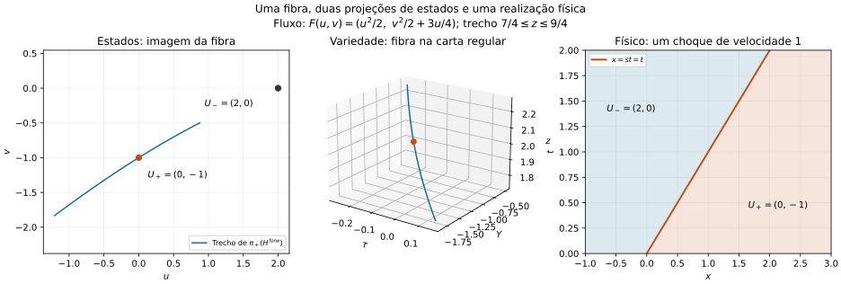
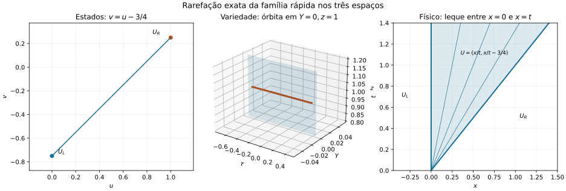
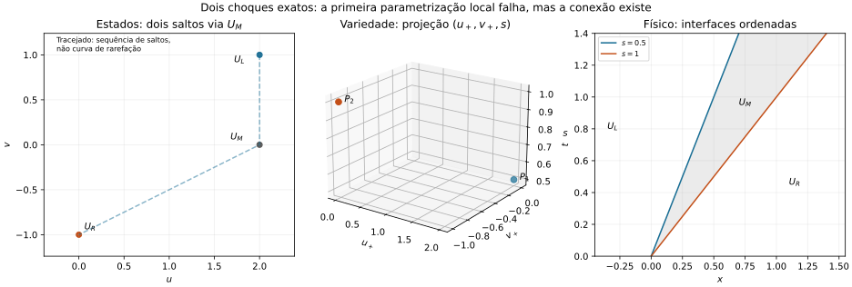
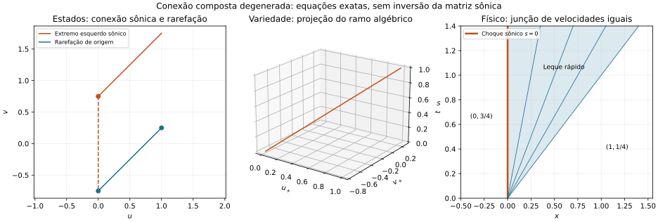
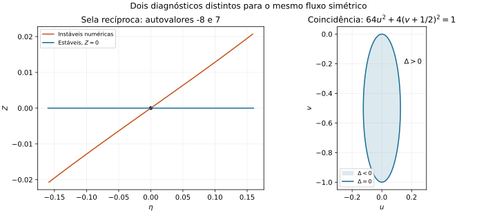

# Exemplos reproduzíveis

## Fibra de Hugoniot nos três espaços

O capítulo exibido no app é [11-fibras-hugoniot.md](../mathematics/11-fibras-hugoniot.md). O arquivo [hugoniot-reference.json](hugoniot-reference.json) contém o fluxo, os estados e as coordenadas exatas esperadas.

| Grandeza | Valor |
|---|---|
| Fluxo | F(u,v) = (u²/2, v²/2 + 3u/4) |
| Estados | U− = (2,0), U+ = (0,−1) |
| Carta finita | τ = −1/8, Y = −1, z = 2 |
| Carta recíproca | η = −1/2, Υ = −2, Z = 1/2 |
| Velocidade e interface | s = 1, x = t |
| Escopo | Solução fraca de um salto, estritamente Lax 2 nos extremos; sem conclusão de unicidade global |

Na raiz do projeto, executar:

```sh
node scripts/hugoniot-reference.mjs --json
node --test tests/hugoniotReferenceExample.test.js
python scripts/plot_hugoniot_reference.py
```

O último comando requer Matplotlib; o script reconhece a instalação local opcional em `.cache/documentation-plotting`. Essa pasta não é versionada. A instalação e a geração devem usar o mesmo interpretador Python, pois há dependências compiladas; nesta etapa foi usado Python 3.12. Se trocar de versão, use um ambiente novo e reinstale as dependências. A geração da figura é opcional para executar os testes ou compilar o app, pois o SVG já está salvo.

Para instalar somente as dependências da figura no projeto:

```sh
python -m pip install --target .cache/documentation-plotting -r docs/examples/requirements-plot.txt
```

O objetivo é reproduzir os dados e a construção gráfica; metadados do SVG e detalhes de fontes podem variar conforme o ambiente.

O JSON de resultados pode ser regenerado sem alterar o fixture de entrada. A figura contém um ramo com 7/4 ≤ z ≤ 9/4 e a realização física apenas do ponto z=2. Não se supõe que o ramo inteiro componha uma única solução física.



As fontes e sua relação com este exemplo estão em [BIBLIOGRAPHY.md](../BIBLIOGRAPHY.md).

## Rarefação e cadeia de dois choques

O mesmo fluxo triangular é usado em dois novos estudos. Os dados estão em [wave-patterns-reference.json](wave-patterns-reference.json), com referência ao fixture original de coeficientes.

| Estudo | Dados | Resultado exato | Limite documentado |
|---|---|---|---|
| [Rarefação](../mathematics/17-campo-rarefacao.md) | (0,−3/4) → (1,1/4) | V(ξ)=(ξ,ξ−3/4) no leque 0≤ξ≤1; z=1, Y=0, τ=3/8−ξ | Interpolação exata neste perfil afim, não em curvas genéricas |
| [Dois choques](../mathematics/20-cadeias-riemann.md) | (2,1) → (2,0) → (0,−1) | Velocidades 1/2 e 1, famílias Lax 1 e 2 | O levantamento do primeiro salto falha na parametrização atual, embora o diferencial de RH tenha posto dois |

Reproduzir com o mesmo ambiente Python/Matplotlib descrito acima:

```sh
node scripts/wave-patterns-reference.mjs --json
node --test tests/wavePatternsReference.test.js
python scripts/plot_wave_patterns_reference.py
```

Os relatórios guardam os resultados numéricos, inclusive arredondamento: a velocidade teoricamente igual a um pode aparecer como 0.9999999999999998. Os testes comparam valores reais com tolerância absoluta de 10⁻¹¹. Não alteram os cálculos para forçar números exatos no relatório.





## Estudos avançados restantes

[advanced-reference.json](advanced-reference.json) registra os dados da conexão composta degenerada, do preset simétrico, da integração local e da transformação afim. Os resultados são gerados pelo núcleo e por substituições explícitas:

```sh
node scripts/advanced-reference.mjs --json
node --test tests/advancedReference.test.js
python scripts/plot_advanced_reference.py
```

Usar o mesmo ambiente de figura dos exemplos anteriores. O caso composto verifica uma junção fraca com velocidades iguais e o perfil de um choque isolado para viscosidade identidade; não executa um solucionador geral de compostas. As instáveis da figura recíproca são aproximações do núcleo; o ramo estável de fronteira possui fórmula exata.




